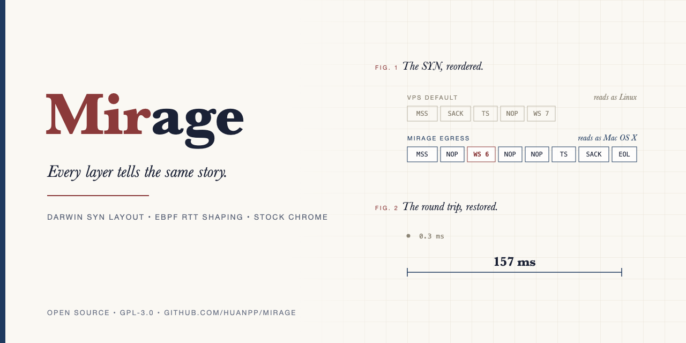

# Mirage

[English](README.md) | 简体中文



Mirage 让代理 VPS 发出的流量看起来来自一台运行原版 Chrome 的 Mac，从 TCP 握手一直到 JS 环境都对得上。

本地跑的是原版 Chrome，TLS、HTTP/2 和 JS 环境本来就是真 Mac 的。Mirage 补的是浏览器管不到的两件事：VPS 出站 TCP 握手暴露的 Linux 协议栈特征，以及代理这一跳带来的 RTT 断层。

## 原理

```
Mac                                         VPS (Linux)                              目标网站
原版 Chrome (TZ / lang 对齐出口)
  -> mihomo / sing-box TUN  ==VLESS REALITY==>  mirage-singbox (出站 SO_MARK 0x4d49)
     IPv6 关闭, UDP 443 拒绝,                     |-> mirage-syn  SYN 重排为 Darwin 形态 ---> L4 判定 macOS
     DNS 走隧道                                   |-> mirage-rtt  ACK 信息整体延迟 -------> TCP RTT = 真实远端 RTT
```

两个整形组件只处理带 mark 的流量，也只改包头。VPS 上的 SSH 和其他服务照常运行。

mirage-syn（nftables + NFQUEUE，Go）把出站 SYN 改写成 macOS 15 的真机形态，依据是从真实 Mac 抓到的包（`captures/macos_syn.txt`）：窗口 65535；选项顺序 `mss, nop, wscale, nop, nop, TS, sackOK, eol`，补齐到 24 字节；IP ID 置 0。wscale 6 由内核自己通告，靠 sysctl 片段设定，所以连接状态与报文始终一致。p0f 实测，原生流量判定为 `Linux 2.2.x-3.x`，改写后判定为 `Mac OS X`。

mirage-rtt（eBPF tc egress + fq 的 EDT 发送时间戳）让目标站在 TCP 层测到的 RTT 等于客户端到 VPS 的真实 RTT。握手阶段，第三次 ACK 和紧随其后的 ClientHello 一起推迟；纯 ACK 按"流基准延迟 + AR(1) 相关抖动"延迟，次序严格单调；数据段按原时机发出，但其中携带的 ACK 号、TSecr 和窗口改写为已经"离开"延迟路径的值，全双工场景下 `min_rtt` 因此也能保持在客户端 RTT 附近。基准延迟默认根据入站连接的 TCP_INFO 自动测量。

## 安装

### VPS

Debian 12 / Ubuntu 22.04 及以上，amd64 或 arm64，需要 root 权限。

```sh
git clone https://github.com/HuanPP/Mirage.git mirage && cd mirage
sudo ./install-vps.sh
```

安装器会编译两个整形组件（缺 Go 时下载固定版本、校验过哈希的官方工具链到 `/opt/mirage/go`），部署独立的 `mirage-singbox.service`（VLESS + REALITY，无需域名和证书），写入 sysctl 片段并启动 systemd 服务。机器上已有的 sing-box、xray 或其他代理服务保持原样。结束时会打印客户端画像，并写入 `/etc/mirage/client/mirage.yaml`。

常用参数：`--port N`、`--sni HOST[:PORT]`、`--no-rtt`、`--dry-run`、`--status`（含一次真实网卡上的 SYN 形态自检）、`--show-client`、`--uninstall`（按安装记录精确回滚）。

注意事项：

1. 请自行在云防火墙中放行所选端口。
2. GCP 默认 MTU 为 1460，会把通告的 MSS 限制在 1420，安装器会给出警告。执行 `gcloud compute networks update <vpc> --mtu=1500` 并重启实例后，可以通告常见的 1460。
3. mirage-rtt 要把出口网卡的 qdisc 换成 fq，只有能生成精确回滚方案时才会安装，否则只运行 mirage-syn 并给出警告。
4. mirage-singbox 通过 `BindsTo=` 绑定整形服务，任一整形服务退出，代理随之停止。NFQUEUE 规则带 `bypass`，守护进程崩溃时流量不会被截断。
5. sysctl 片段把全局 `tcp_rmem` 与 `rmem_max` 上限降到 2 MiB 以得到 wscale 6，单流吞吐上限约为 2 MiB / RTT。

### Mac

macOS 13 及以上，默认路径无需 sudo。

```sh
git clone https://github.com/HuanPP/Mirage.git mirage && cd mirage
./install-local.sh --import <mirage.yaml 的路径或 https 地址>
```

画像文件本身是一份合法的 mihomo 配置（TUN、仅 IPv4、拒绝 UDP 443 以禁用 QUIC、DNS 经隧道走 DoH、单一出口），多出一个顶层 `mirage:` 段，记录出口 IP、时区、语言和画像名，mihomo 会忽略它。把文件导入 Clash Verge Rev 或 mihomo，开启 TUN，然后运行：

```sh
mirage-launch            # 启动对齐后的独立 Chrome 实例
mirage-launch --print    # 只打印解析后的命令
mirage-launch --check    # 检查出口 IP、时区和 IPv6 可达性
```

`mirage-launch` 先比较当前出口 IP 与画像中的 `expect_egress`，不一致就中止，隧道没开或节点选错时也就不会裸连。随后以独立配置目录启动 Chrome，带上 `TZ=<时区>`（macOS 上的 Chrome 认这个变量，已实测）、`--lang`、`--accept-lang`、`--disable-quic` 和 `--enforce-webrtc-ip-permission-check`。这个实例没有调试端口，系统时区和你日常使用的 Chrome 保持原样。

`--with-mihomo` 会下载固定版本的官方 mihomo 到 `~/.mirage/bin`，并打印启动 TUN 所需的 sudo 命令，由你自己执行。

## 已知限制

1. v1 只支持 IPv4，带 mark 的 IPv6 SYN 默认直接丢弃。
2. 机房 ASN 仍是机房 ASN，要像家庭用户，需要 ISP 或住宅线路。
3. 对 VPS 执行 `nmap -O` 仍会识别成 Linux，请用防火墙收紧入站端口。
4. 数据段中的 SACK 块原样通过，可能比延迟后的 ACK 更新。
5. mirage-rtt 遇到无法精确还原 qdisc 布局的网卡会拒绝安装。

## 许可证

[GPL-3.0](LICENSE)。`mangler/rtt/internal/shaper/bpf.c` 中的 eBPF 程序声明为 GPL，这是内核允许它调用所用 helper 的前提。
